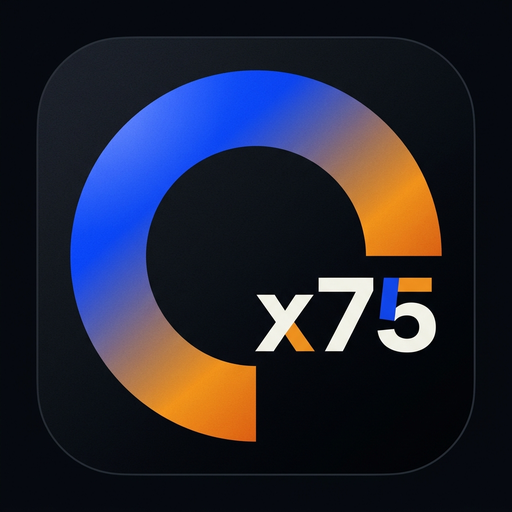
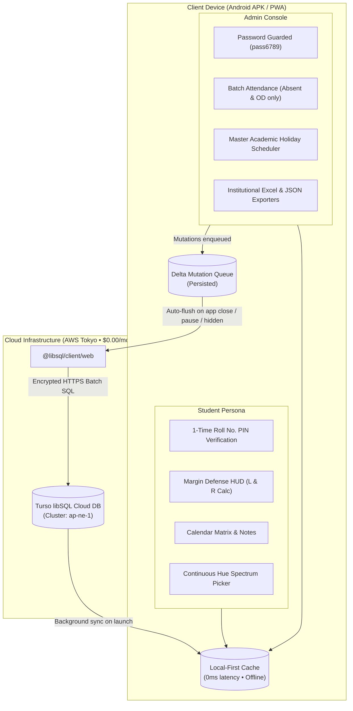

<div align="center">

  

  # x75

  **Minimalist Margin Defense & Cohort Attendance Architecture for Android & Web**

  [](#)
  [](#)
  [](#)
  [](#)
  [](#)

  <p align="center">
    <i>Engineered for academic cohorts enforcing strict statutory attendance thresholds.<br />Zero clutter. Zero hourly timetable bloat. Tactical margin mathematics.</i>
  </p>

</div>

---

## Overview

Traditional student portals force users through slow hourly timetables, session codes, and bloated web portals. **x75** strips collegiate attendance tracking down to its fundamental truth: **discrete calendar days and statutory margin defense**.

Built as an edge-to-edge native Android application and offline-first Progressive Web App, **x75** pairs an institutional batch-marking console for administrators with an actionable, margin-centric personal HUD for students.

```
                      75% STATUTORY THRESHOLD
        [ DEFICIT REGION ]               [ SURPLUS REGION ]
◄───────────────────────────────────┼───────────────────────────────────►
  Must attend R consecutive days     Can safely miss L consecutive days
```

---

## Tactical Margin Mathematics

Rather than displaying abstract percentages, **x75** converts raw attendance into actionable operational directives using discrete integer arithmetic.

Let:
- $A$: Attended working instructional days ($\text{PRESENT} + \text{DUTY\_LEAVE}$)
- $C$: Total conducted instructional days ($\text{PRESENT} + \text{ABSENT} + \text{DUTY\_LEAVE}$)
- $T$: Statutory minimum attendance percentage threshold ($50 \le T \le 95$, default $75\%$)

Current attendance percentage:
$$P = \frac{A}{C} \times 100$$

### 1. Bunk Allowance (Surplus Margin)
When $P \ge T$, the student is in a safe margin. The maximum number of consecutive instructional days $L$ the student can miss without dropping below $T$:

$$L = \left\lfloor \frac{100A - TC}{T} \right\rfloor$$

> **Direct Output**: `"3 days available"` — unambiguous permission to take personal time without risking academic debarment.

### 2. Recovery Requirement (Deficit Margin)
When $P < T$, the student has breached the margin. The minimum number of consecutive instructional days $R$ the student must attend without a single absence to restore compliance:

$$R = \left\lceil \frac{TC - 100A}{100 - T} \right\rceil$$

> **Direct Output**: `"Attend next 4 days without absence"` — a clear, mathematical recovery plan.

---

## Dual Persona Architecture



### 🧑‍🎓 Student Persona
* **1-Time Cryptographic Roll No. Setup**: Students select their profile from the roster and authenticate once using their private institutional enrollment number. Zero credentials exposed in plaintext.
* **Margin Defense HUD**: High-contrast geometric 270° threshold gauge indicating live standing, surplus bunk days, or deficit recovery targets.
* **Calendar Matrix**: Month-by-month calendar matrix with custom status tags (`PRESENT`, `ABSENT`, `OD`, `HOLIDAY`) and private notes.
* **Continuous Hue Spectrum**: Fluid color customization without hex codes, featuring continuous rainbow spectrum slider and curated tone swatches.

### 🛡️ Admin Console
* **Password Guarded**: Gated behind secure administrative passkey authentication (`pass6789`).
* **Fast Batch Logging**: Instead of 60 individual clicks, administrators select the date, check only the students who are **Absent** or on **Duty Leave (OD)**, and tap **"Mark Rest Present"**.
* **Automatic Sunday Exclusion**: All Sundays and declared holidays are automatically filtered out from attendance tallies.
* **Master Calendar Management**: Add and delete institutional holidays with one tap.
* **HOD Institutional Spreadsheet Export**: One-click generation of the exact departmental attendance spreadsheet format required by collegiate administrations (formatted with Mechatronics Department header, `DD.MM.YY` columns, official status codes, and aggregate percentages).
* **Raw JSON Export**: Full cohort database exportable as standardized JSON for archival or custom processing in any LLM or data pipeline.

---

## Database & Cloud Architecture

* **Database Engine**: [Turso](https://turso.tech/) (Managed distributed libSQL / SQLite engine)
* **Cluster Region**: AWS Tokyo (`aws-ap-northeast-1`)
* **Operating Cost**: strictly **$0.00 / month** (consumes $< 0.01\%$ of Turso's 25M writes and 1B reads monthly quota).
* **Zero-Click Automated Sync**:
  * No manual "push" or "pull" buttons cluttering the UI.
  * Local mutations are committed instantly to `localStorage` (0ms UI latency).
  * Automatically flushes all pending deltas to the cloud when the app is minimized, closed, or switched (`visibilitychange`, `pagehide`, Capacitor `pause`).
  * Seamless background delta pulling on cold boot.

```sql
-- Production Relational Schema
CREATE TABLE students (
  enroll_no TEXT PRIMARY KEY,
  name TEXT NOT NULL,
  dept TEXT DEFAULT 'Mechatronics',
  batch TEXT DEFAULT '2026-2030',
  section TEXT DEFAULT 'A'
);

CREATE TABLE college_calendar (
  date TEXT PRIMARY KEY,
  is_holiday INTEGER DEFAULT 0,
  note TEXT DEFAULT ''
);

CREATE TABLE attendance_records (
  id INTEGER PRIMARY KEY AUTOINCREMENT,
  enroll_no TEXT NOT NULL,
  date TEXT NOT NULL,
  status TEXT NOT NULL CHECK(status IN ('PRESENT', 'ABSENT', 'DUTY_LEAVE')),
  note TEXT DEFAULT '',
  updated_at DATETIME DEFAULT CURRENT_TIMESTAMP,
  UNIQUE(enroll_no, date)
);
```

---

## Android Native Features

* **Strict Portrait Lock**: Configured via `android:screenOrientation="portrait"` to prevent unwanted layout shifting.
* **Adaptive Edge-to-Edge Chassis**: Zero side letterboxing or black bars on modern Android viewport widths (412px, 430px, 448px).
* **Adaptive Launcher Icons**: Custom Bauhaus typography monogram icon supporting standard, circular, and Android 8.0+ adaptive icon layers across all density buckets (`mdpi` to `xxxhdpi`).
* **Hardware Back Gesture Integration**: Intercepts native Android back gestures to dismiss modals, back out of admin view, and exit cleanly without orphaned activity state.
* **Tactile Synthetic Audio**: Configurable synthetic acoustic click feedback synthesized natively via the Web Audio API without bulky audio assets.

---

## Tech Stack

| Layer | Technology |
| :--- | :--- |
| **Frontend Framework** | React 18 (Hooks, Memoization, Context) |
| **Build Tool** | Vite 6 (Lightning Fast HMR, Tree-shaking) |
| **Styling** | Tailwind CSS + Custom CSS Variables |
| **Icons** | Lucide React |
| **Mobile Runtime** | Capacitor 8 (Android & iOS Bridge) |
| **Cloud Database** | Turso (libSQL Cloud Engine over HTTP) |
| **Audio Feedback** | Web Audio API (Synthetic Pulse Generator) |

---

## Getting Started

### Prerequisites
* **Node.js**: `v18.0.0+`
* **JDK**: `21` (for Android build)
* **Android SDK**: `build-tools 35.0.0+`

### Installation

```bash
git clone git@github.com:xengoski/x75.git
cd x75
npm install
```

### Environment Configuration

Create a `.env` file from the provided template:

```bash
cp .env.example .env
```

Set your Turso database credentials:
```env
VITE_TURSO_DATABASE_URL=https://x75-attendance-xengoski.aws-ap-northeast-1.turso.io
VITE_TURSO_AUTH_TOKEN=your-turso-auth-token-here
```

### Web Development Server

```bash
npm run dev
# Starts local Vite server at http://localhost:5173
```

### Compile & Build Android APK

```bash
# 1. Compile web assets and sync to native Android container
npm run cap:build

# 2. Compile native Android Debug APK
npm run build:apk

# The generated APK will be located at:
# android/app/build/outputs/apk/debug/app-debug.apk
```

---

## Releases & Installation

Official standalone Android `.apk` builds are published under [**Releases**](https://github.com/xengoski/x75/releases).

| Application | Package ID | Target Audience | Direct Download |
| :--- | :--- | :--- | :--- |
| **`x75 Student`** | `com.x75.app` | Cohort Students (Margin HUD, 1-Time Setup) | [**x75-v1.0.apk**](https://github.com/xengoski/x75/releases/download/v1.0.0/x75-v1.0.apk) |
| **`x75 Admin`** | `com.x75.admin` | Class Reps & Admins (Batch Marking, Cloud Sync) | [**x75-admin-v1.0.apk**](https://github.com/xengoski/x75/releases/download/v1.0.0/x75-admin-v1.0.apk) |

> **Side-by-Side Installation**: Both APKs feature distinct package IDs and can be installed simultaneously on the same Android device.

---

## License

Distributed under the **MIT License**. Built with precision for the Department of Mechatronics Engineering.
